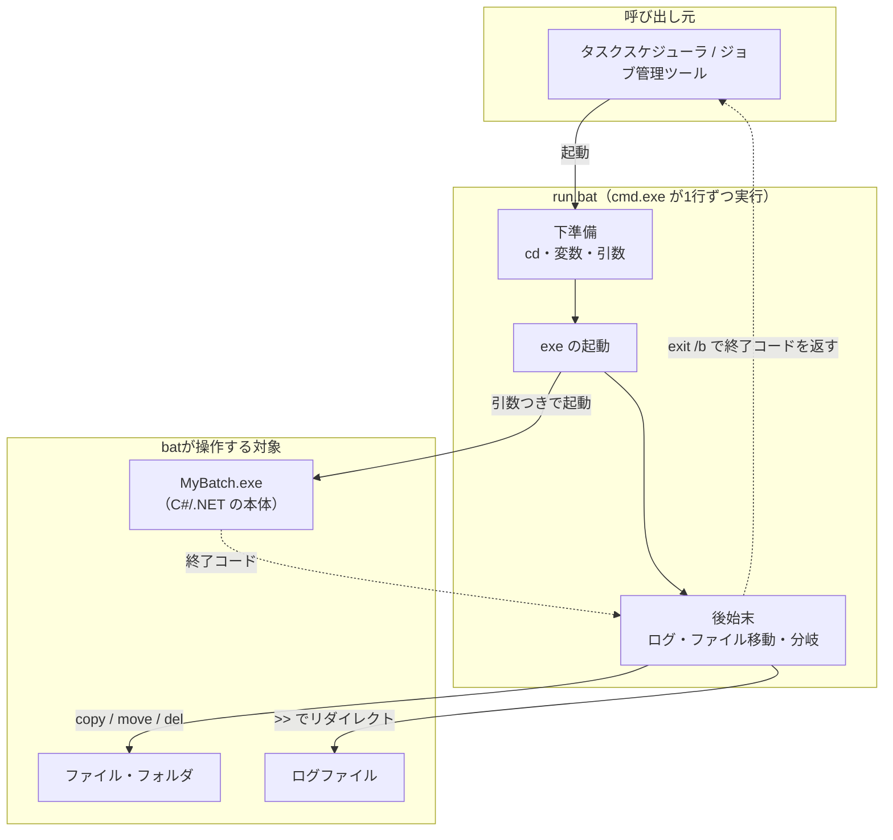

# batファイル

## 概要
コマンドプロンプト（cmd.exe）に打つコマンドを、上から順に自動で実行させるWindowsのスクリプト。バッチでは、batで特定の実行ファイル（exe）を起動する「段取り役」として使われる。

## 理解したこと

### 全体像



---

### 典型的な形（bat → exe）

```bat
@echo off
cd /d D:\batch\MyBatch
MyBatch.exe 20261013 >> logs\run.log 2>&1
exit /b %ERRORLEVEL%
```

| 行 | やっていること |
|---|---|
| `cd /d ...` | 作業フォルダを移動（設定ファイルを相対パスで読めるようにする） |
| `MyBatch.exe 20261013` | 本体を処理日などの引数つきで起動 |
| `>> logs\run.log 2>&1` | 出力をログに残す（夜間は誰も画面を見ていない） |
| `exit /b %ERRORLEVEL%` | exe の終了コードを呼び出し元に返す。スケジューラはこれで成否を判断する |

---

### できること

| 分類 | 例 | 内容 |
|---|---|---|
| プログラムの起動 | `MyBatch.exe`、`call other.bat` | exe や別の bat を起動 |
| ファイル操作 | `copy` / `move` / `del` / `mkdir` / `robocopy` | 移動・バックアップ・古いログの削除 |
| 変数・引数 | `set X=...`、`%1` | 値の使い回し、起動時の値の受け取り |
| 条件分岐 | `if errorlevel 1`、`if exist` | 失敗やファイルの有無で処理を分ける |
| 繰り返し | `for %%f in (*.csv) do` | ファイルを1つずつ処理 |
| ジャンプ | `goto :ERROR` | エラー処理に飛ぶ |
| 出力の制御 | `>`、`>>`、`2>&1` | 結果をファイルに書き出す |

---

### 苦手なこと

| 苦手 | 理由 |
|---|---|
| 複雑なロジック | 書き方のクセが強く、すぐ読みにくくなる |
| 文字列・日付の加工 | 機能が貧弱。`%date%` の形式もPCの設定で変わる |
| エラー処理 | 終了コードを毎回自分で確認するしかない |
| DBアクセス・データ加工 | 自分ではできない。それができる exe を呼ぶ |

なので bat は段取り役、重い中身は C# などで書いた exe、という役割分担になる。

---

### 似た役割のスクリプト

| | OS | 位置づけ |
|---|---|---|
| bat（`.bat`） | Windows | 古くからある。シンプルだが機能は貧弱 |
| PowerShell（`.ps1`） | Windows | bat の上位互換。新しく作るときはこちらが選ばれることも多い |
| シェルスクリプト（`.sh`） | Linux | Linux で同じ役割をするもの |

---

## 関連概念
- [batch_processing](batch_processing.md)（batはバッチ処理の「何で書くか」のうち、起動役を担う）

## ソース
- 2026-10-13・会話ベースの壁打ち

## タグ
bat, バッチファイル, cmd.exe, コマンドプロンプト, Windows, exe, 終了コード, ERRORLEVEL, PowerShell, シェルスクリプト, スクリプト
