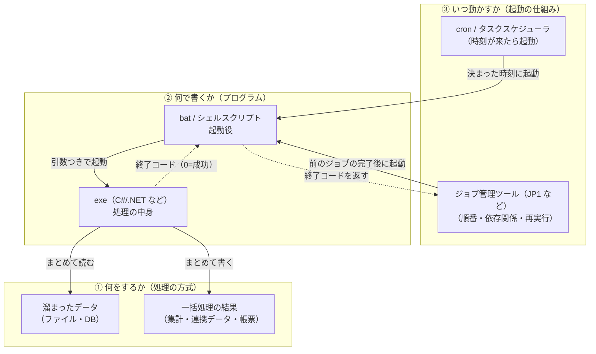

# バッチ処理

## 概要
データを溜めて、まとめて一括で処理する方式。ファイル形式ではなく処理のやり方の名前で、夜間などに cron やタスクスケジューラで自動実行されることが多い。

## 理解したこと

### 全体像

---

### 「バッチ」と呼ばれる3つのもの

| 面 | 中身 | 例 |
|---|---|---|
| ① 何をするか | バッチ処理＝まとめて一括で処理する方式 | 日次集計、データ連携、請求データ作成 |
| ② 何で書くか | 処理を実装したプログラム | C#(.NET)のコンソールアプリ（exe）、bat、シェルスクリプト、Python |
| ③ いつ動かすか | 自動実行の仕組み | cron（Linux）、タスクスケジューラ（Windows）、ジョブ管理ツール |

「自動実行ができる形式」ではなく、③の仕組みが②のプログラムを決まった時刻に起動している。

---

### オンライン処理との違い

| | オンライン処理 | バッチ処理 |
|---|---|---|
| きっかけ | ユーザーの操作（リクエスト） | 決まった時刻・前の処理の完了 |
| 処理の単位 | 1件ずつ、その場で | 溜まったデータをまとめて一括 |
| 重視する指標 | レスポンスタイム | スループット |
| 例 | 画面での登録・検索 | 日次集計、ファイル取り込み |

---

### なぜ夜間に流すのか

| 理由 | 内容 |
|---|---|
| オンライン処理の邪魔をしない | 重い処理を昼に流すと画面操作が遅くなる |
| データの確定を待つ | その日の業務が終わってから「日次の締め」として処理する |
| 依存関係がある | 取り込み → 変換 → 集計 → 帳票のように、前の処理の完了を待って次を動かす |

依存関係があるので、現場ではバッチを1つ1つの**ジョブ**として扱い、ジョブ管理ツールで順番や再実行を管理する。cron は「時刻が来たら起動する」だけなので、大きなシステムでは足りなくなる。

---

## 関連概念
- [bat_file](bat_file.md)（Windowsでバッチの起動役になるスクリプト。batで特定の実行ファイルを起動する）
- [hardware_sizing](hardware_sizing.md)（レスポンスタイムとスループットの対比が、オンライン処理とバッチ処理の違いに対応する）
- [claude_code_scheduled_tasks](claude_code_scheduled_tasks.md)（cron的なスケジュール実行の一例）

## ソース
- 2026-10-13・会話ベースの壁打ち

## タグ
バッチ処理, オンライン処理, 夜間バッチ, ジョブ, ジョブ管理ツール, cron, タスクスケジューラ, スループット, 自動実行, exe
