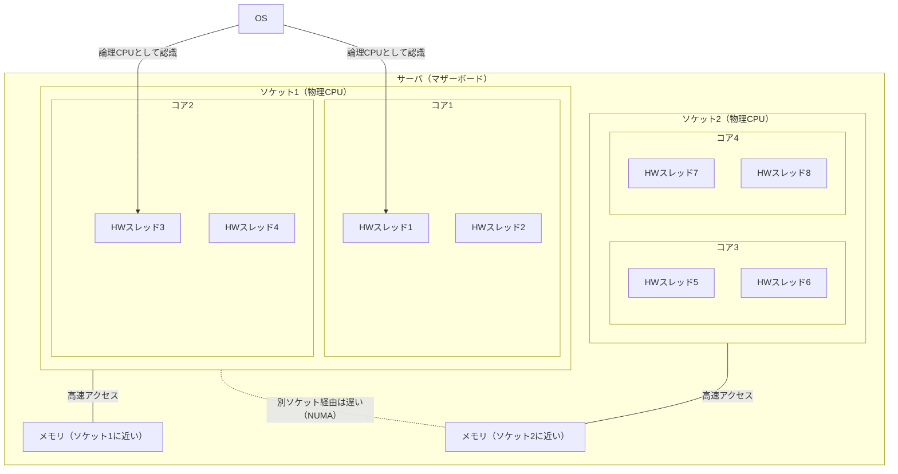

# CPUトポロジー（ソケット・コア・スレッド）

## 概要
CPUの物理的な構成を表す3段の階層。ソケット数が物理的なCPUの設置できる数、コアがCPUの核で、一般的には1つのCPUに対して複数のコアがある。スレッドは1コアを複数に見せる仕組みで、OSからはスレッドの数だけCPUがあるように見える。

## 理解したこと

### 全体像



---

### 3つの階層

| 階層 | 正体 | 一言 |
|---|---|---|
| ソケット | マザーボード上のCPUを挿す台座 | 物理的なCPUの設置できる数（通常は実際に載っている数を指す） |
| コア | 実際に計算する回路 | CPUの核。1つのCPUに複数あるのが普通 |
| スレッド（ハードウェアスレッド） | 1コアを2つに見せる仕組み（ハイパースレッディング） | OSから見える「CPU」の単位＝論理CPU |

OSから見えるCPUの数は掛け算で決まる。

```
論理CPU数 = ソケット数 × コア数/ソケット × スレッド数/コア
図の場合:       2 × 2  × 2 = 8
実際のサーバ例: 2 × 16 × 2 = 64
```

---

### なぜソケットを区別するのか

普通のPC・Macは1ソケットなので意識しない。複数ソケットのサーバで差が出る。

| 観点 | 内容 |
|---|---|
| 性能（NUMA） | ソケットごとに「近いメモリ」がある。別ソケット側のメモリへのアクセスは遅くなるため、同じ論理CPU数でも1ソケットと2ソケットで特性が変わる |
| ライセンス | ソフトウェアによってはソケット単位・コア単位で課金される。数え方でコストが変わる |

---

### 確認方法

| 環境 | コマンド | 見えるもの |
|---|---|---|
| Linux | `lscpu` | `Socket(s)` / `Core(s) per socket` / `Thread(s) per core` |
| macOS | `sysctl hw.physicalcpu hw.logicalcpu` | 物理コア数 / 論理CPU数 |

---

### 混同ポイント

| 用語 | ここでの意味 | 別物 |
|---|---|---|
| ソケット | CPUを挿す台座 | ネットワークのソケット（IPアドレス＋ポート番号の通信の出入口）。どちらも「差し込み口」の比喩なだけで無関係 |
| スレッド | ハードウェアスレッド（CPUの機能） | ソフトウェアスレッド（プログラムの実行の流れ）→ process_thread |

---

## 関連概念
- [computer_architecture](computer_architecture.md)（CPU内部の論理構成＝制御装置・演算装置・レジスタ。こちらは物理的な数の構成）
- [memory_hierarchy](memory_hierarchy.md)（CPUに近いほど速い、の延長がNUMA）
- [process_thread](process_thread.md)（OSがソフトウェアスレッドを論理CPUに割り当てる）
- [hardware_sizing](hardware_sizing.md)（コア数・ソケット数がサイジングとライセンス費に効く）

## ソース
- 2026-10-13・https://milestone-of-se.nesuke.com/sv-basic/architecture/cpu/
- 2026-10-13・会話ベースの壁打ち

## タグ
CPU, ソケット, コア, スレッド, ハイパースレッディング, 論理CPU, NUMA, lscpu, ハードウェア, ライセンス
