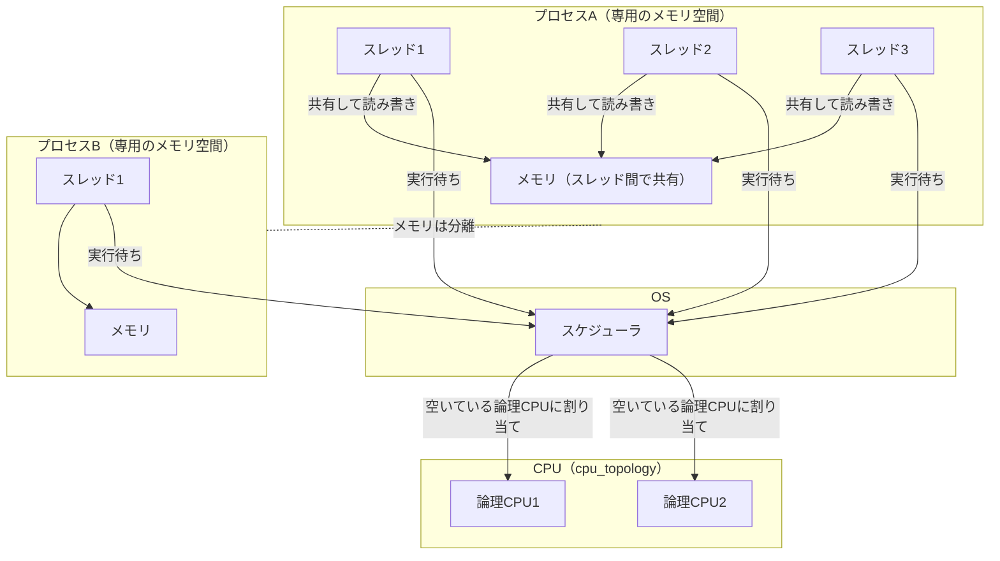

# プロセスとスレッド

## 概要
プロセスはメモリ空間などの資源を持つ「入れ物」で、スレッドはその中で動く「実行の流れ」。プロセスはおおむね複数のスレッドの集まりで、OSがスレッドを空いている論理CPUに割り当てて実行させる。

## 理解したこと

### 全体像

---

### プロセスとスレッドの違い

| | プロセス | スレッド |
|---|---|---|
| 役割 | 入れ物（メモリ空間・ファイルなどの資源を持つ） | 実行の流れ1本 |
| 数の関係 | 最低1本のスレッドを持つ | 必ずどれかのプロセスに属する |
| メモリ | プロセス同士は分離されている | 同じプロセス内のスレッド同士で共有（速いが競合に注意） |

---

### 2つの「スレッド」

同じ言葉で別物を指すので混同しやすい。

| | ハードウェアスレッド | ソフトウェアスレッド |
|---|---|---|
| どこにある | CPUの中（コアの機能） | OS／プログラムの中（状態はメモリ上） |
| 正体 | 1コアを2つに見せる仕組み | プログラムの実行の流れ |
| 数 | 固定（例: 16コア × 2 = 32） | いくらでも作れる（数百〜数千） |
| 例 | スペック表の「コア数・スレッド数」 | 「マルチスレッド」のスレッド |

---

### 誤解していたポイント

| 誤解 | 正しくは |
|---|---|
| スレッドが空いているコアに処理を投げる | **OSが**、ソフトウェアスレッドを空いている論理CPU（ハードウェアスレッド）に割り当てる |
| スレッドはメモリ上にある（CPUのスレッドも同じもの） | メモリ上に状態があるのはソフトウェアスレッド。CPUのスレッドはハードウェアの機能で別物 |

論理CPUよりスレッドが多いときは、OSが短い時間で切り替えながら回す（コンテキストスイッチ）。

---

## 関連概念
- [cpu_topology](cpu_topology.md)（スレッドの割り当て先＝論理CPUの物理的な構成）
- [memory_hierarchy](memory_hierarchy.md)（プロセスのメモリ空間やスレッドの状態が置かれるのはRAM）

## ソース
- 2026-10-13・会話ベースの壁打ち

## タグ
プロセス, スレッド, マルチスレッド, ソフトウェアスレッド, ハードウェアスレッド, スケジューラ, コンテキストスイッチ, メモリ空間, OS
